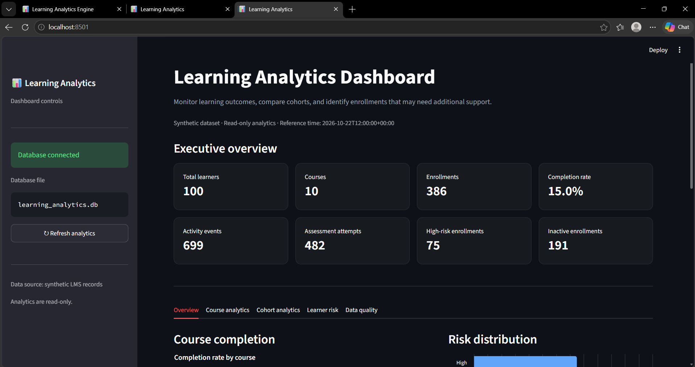
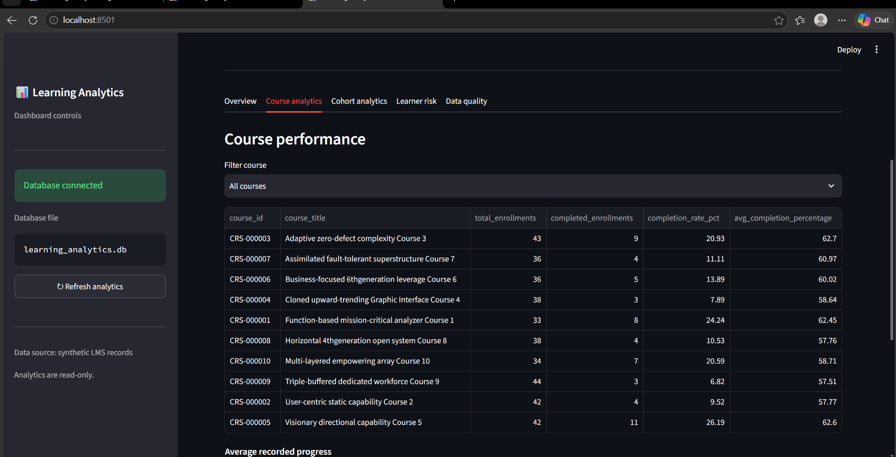
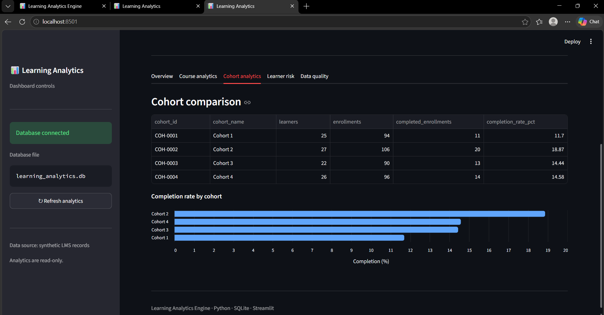
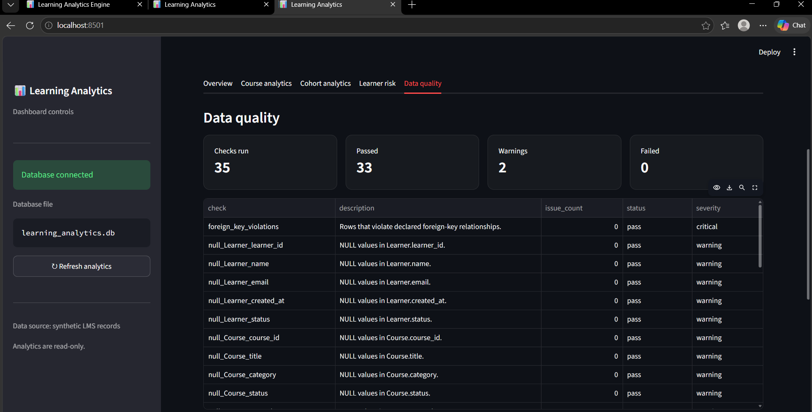

# Learning Analytics Engine

A reproducible synthetic learning analytics pipeline built with Python, SQLite, SQL, and Streamlit. The project generates LMS data at starter and full scales, validates relational integrity, detects data-quality anomalies, calculates learning metrics, evaluates learner risk, and provides an interactive dashboard for exploring learning outcomes.

**Repository:** [1616piyu/learning-analytics-engine](https://github.com/1616piyu/learning-analytics-engine)

[](https://github.com/1616piyu/learning-analytics-engine/actions/workflows/tests.yml)

All learner, course, enrollment, activity, and assessment records are synthetic. They do not represent real learners or production LMS statistics.

## Project Overview

The pipeline:

1. Generates learners, courses, cohorts, enrollments, content, assessments, activity events, attempts, and course outcomes.
2. Stores records in a relational SQLite database.
3. Validates database integrity, foreign-key relationships, and implemented data-quality rules.
4. Detects duplicate activity, unenrolled activity, invalid completion outcomes, and timezone-boundary candidates.
5. Calculates course completion, assessment performance, and learner engagement metrics.
6. Analyzes cohort performance and identifies inactive enrollments.
7. Assigns explainable risk scores to ongoing enrollments, with contributing reasons and recommended interventions.
8. Produces data-quality summaries that distinguish passing checks, warnings, and failures.
9. Exports table data as CSV and JSONL, together with a SQL seed, JSON summary, and integrity manifest.
10. Evaluates anomaly detection against separate ground-truth labels.
11. Provides an interactive Streamlit dashboard for exploring metrics, cohorts, learner risk, and data quality.
12. Runs automated tests for correctness and reproducibility.


## Dashboard Preview

The interactive dashboard provides an overview of learning outcomes, course performance, cohort comparisons, learner risk, and data quality.

### Executive Overview


### Course Analytics


### Cohort Analytics


### Data Quality



## Key Features

### 1. Synthetic Data Generation

- Generates reproducible sample data for a learning platform.
- Uses a fixed random seed and reference timestamp.
- Supports starter and full-scale dataset profiles.
- Supports a configurable SQLite database path.
- Refuses to overwrite an existing database.

### 2. Data Integrity and Quality Validation

Implemented checks cover:

- Foreign-key violations.
- Required tables and columns.
- Null values in checked fields.
- Duplicate IDs in checked entities.
- Duplicate source-event identifiers.
- Data and business-rule constraints covered by the validation code.

Data-quality results are classified as **passed**, **warnings**, or **failures**, based on the configured check severity and observed issues. Warnings remain visible for investigation rather than being hidden as successful checks.

### 3. Rule-Based Anomaly Detection

The detector checks for:

- Duplicate activity events based on source-event identity.
- Activity events without a valid enrollment.
- Completed outcomes without a passing required assessment.
- Timezone-boundary candidates where the local calendar date differs from the UTC date.

Timezone-boundary findings are candidates for review, not necessarily confirmed data errors.

The detector uses deterministic rules rather than a trained machine-learning anomaly classifier.

### 4. Learning Analytics and Reporting

The reporting pipeline provides:

- Overall dataset metrics.
- Course completion metrics.
- Assessment performance.
- Learner engagement.
- Cohort performance.
- Inactive enrollment metrics.
- Explainable learner risk scores.
- Data-quality checks and issue summaries.
- Anomaly findings grouped by issue type.

Learner risk assessments include contributing reasons and recommended interventions to help explain why an ongoing enrollment may need attention. These are rule-based indicators over synthetic data, not validated predictions of actual learner outcomes.

The anomaly status is `clean` when no findings are detected and `needs_investigation` when findings are present.

### 5. Interactive Streamlit Dashboard

The dashboard provides five main sections:

- **Overview:** Summary metrics and high-level project indicators.
- **Course analytics:** Course-level performance and completion comparisons.
- **Cohort analytics:** Performance comparisons across learner cohorts.
- **Learner risk:** Risk distribution, learner filtering, search, and risk details.
- **Data quality:** Check totals, warnings, failures, and anomaly summaries.

The dashboard reads analytics from the project's SQLite database through the reporting layer. The report generator opens the database in read-only mode.

The dashboard currently runs locally; it is not a hosted production application.

### 6. Dataset Exports

The exporter produces:

- **CSV:** One file per table.
- **JSONL:** One JSON record per line, in one file per table.
- **SQL seed:** `learning_analytics_seed.sql`, containing schema and table data.
- **JSON summary:** `dataset_summary.json`, containing table counts and metadata.
- **SHA-256 manifest:** `export_manifest.json`, containing row counts, columns, file sizes, and checksums for exported files.

The exporter checks foreign-key integrity before exporting and processes records in batches.

## Dataset Profiles

| Entity | Starter | Full |
|---|---:|---:|
| Learners | 100 | 20,000 |
| Courses | 10 | 500 |
| Cohorts | 4 | 20 |
| Content items | 40 | 2,000 |
| Assessments | 10 | 500 |
| Completion rules | 10 | 500 |
| Enrollments | 386 | 100,000 |
| Learner-cohort memberships | 100 | 20,000 |
| Activity events | 695 | 2,000,000 |
| Assessment attempts | 482 | 127,637 |
| Course outcomes | 386 | 100,000 |

The starter counts reflect the established starter configuration. The full-scale counts were verified against the generated database.

## Technology Stack

- **Language:** Python
- **Database:** SQLite
- **Analytics:** SQL
- **Dashboard:** Streamlit
- **Visualization:** Altair
- **Data handling:** pandas
- **Export formats:** CSV, JSONL, SQL, JSON
- **Testing:** pytest
- **Version control:** Git and GitHub
- **Continuous integration:** GitHub Actions

## Architecture

```text
Configuration and Seed
          |
          v
Synthetic Data Generators
          |
          v
    SQLite Database
          |
          +-----------------------+
          |                       |
          v                       v
   Integrity Checks       Anomaly Detection
          |                       |
          +-----------+-----------+
                      |
                      v
             Analytics Reporting
                      |
           +----------+-----------+
           |          |           |
           v          v           v
        JSON/CSV   Learner Risk  Data Quality
        Exports    and Cohorts   Summaries
                      |
                      v
             Streamlit Dashboard
```

## Project Structure

```text
learning-analytics-engine/
├── data/
│   └── ground_truth/
├── docs/
│   ├── business_rules.md
│   ├── data_dictionary.md
│   ├── er_diagram.md
│   └── source_manifest.md
├── src/
│   ├── database/
│   │   ├── analytics.sql
│   │   ├── completion_metrics.sql
│   │   ├── init_db.py
│   │   └── schema.sql
│   ├── generator/
│   ├── reporting/
│   │   ├── business_metrics.py
│   │   ├── generate_report.py
│   │   └── learner_risk.py
│   ├── validation/
│   │   ├── anomaly_detector.py
│   │   ├── checksum.py
│   │   ├── evaluate_anomalies.py
│   │   ├── inject_anomalies.py
│   │   └── integrity.py
│   ├── dashboard/
│   │   └── app.py
│   ├── build_pipeline.py
│   └── export_dataset.py
├── tests/
├── requirements.txt
├── .gitignore
└── README.md
```

Generated databases and export directories are recreated locally and are excluded from version control. The structure above highlights the main project components; it is not intended to list every file.

## Getting Started

### Prerequisites

- Python 3.11 or a compatible Python version.
- Git.
- PowerShell on Windows, or an equivalent terminal.

### 1. Clone the Repository

```powershell
git clone https://github.com/1616piyu/learning-analytics-engine.git
cd learning-analytics-engine
```

### 2. Create and Activate a Virtual Environment

**Windows PowerShell**

```powershell
python -m venv .venv
.\.venv\Scripts\Activate.ps1
```

**macOS or Linux**

```bash
python3 -m venv .venv
source .venv/bin/activate
```

### 3. Install Dependencies

```powershell
python -m pip install -r requirements.txt
```

### 4. Run the Tests

```powershell
python -m pytest -q
```

The latest verified local test run passed **33 tests**. Run the command again after making changes to confirm the current result.

### 5. Build a Database

The pipeline refuses to overwrite an existing database. Use a new filename for each build.

**Starter profile**

```powershell
python -m src.build_pipeline --scale starter --db .\data\starter_submission.db
```

**Full-scale profile**

```powershell
python -m src.build_pipeline --scale full --db .\data\learning_analytics_full.db
```

The full profile targets 20,000 learners, 500 courses, 100,000 enrollments, and 2,000,000 activity events.

Generated database files are ignored by Git.

### 6. Launch the Dashboard

First, ensure that the database expected by the reporting configuration exists. By default, the report generator uses:

`data/learning_analytics.db`

If you generated a database using one of the alternative filenames above, either configure the project to use that database through its supported configuration or generate the database at the expected path. Do not overwrite an existing database.

Launch Streamlit from the project root:

```powershell
python -m streamlit run src/dashboard/app.py
```

Open the local URL printed in the terminal, usually:

`http://localhost:8501`

To stop the dashboard, press `Ctrl+C` in the terminal running Streamlit.

### 7. Generate a JSON Report

The reporting module supports building a report from a specified database and writing it to a new output filename.

For example, after generating the full-scale database:

```powershell
python -c "from pathlib import Path; from src.reporting.generate_report import build_report, write_report; db=Path('data/learning_analytics_full.db').resolve(); report=build_report(db); write_report(report, Path('reports/full_scale_report.json'))"
```

Create the `reports` directory if it does not already exist:

```powershell
New-Item -ItemType Directory -Force reports
```

If the report already exists, choose a different output filename. The report writer intentionally refuses to overwrite existing reports.

### 8. Export the Dataset

After generating the full-scale database, run:

```powershell
python -m src.export_dataset
```

By default, the exporter reads `data/learning_analytics_full.db` and writes to `data/exports/`.

## Anomaly Evaluation

Evaluation compares detector findings with labels stored separately from the detector features. Ground-truth labels must not be used as detector features.

After building the full-scale database, create a separate test copy.

**Important:** Run anomaly injection only once against a fresh copy of the full-scale database. For repeat evaluations, create a new database copy before running the injector again. The ground-truth CSV is generated by the injector and is intentionally excluded from version control.

```powershell
Copy-Item .\data\learning_analytics_full.db .\data\learning_analytics_anomaly_test.db

$env:LEARNING_ANALYTICS_DB = (Resolve-Path .\data\learning_analytics_anomaly_test.db).Path

$env:LEARNING_ANALYTICS_GROUND_TRUTH = Join-Path (Get-Location).Path "data\ground_truth\full_scale_ground_truth.csv"

python -m src.validation.inject_anomalies
python -m src.validation.evaluate_anomalies
```

Run these commands in the same PowerShell session so the environment variables remain set.

The injector creates five labelled records: two duplicate-event records, one unenrolled activity event, one invalid completion outcome, and one timezone review case.

### Recorded Evaluation

| Metric | Result |
|---|---:|
| Expected actionable labels | 4 |
| True positives | 4 |
| False positives | 0 |
| False negatives | 0 |
| Precision | 100% |
| Recall | 100% |
| Review cases detected | 1 of 1 |

These results apply to the injected test cases. They do not establish equivalent performance on every possible anomaly or real-world data.

## Full-Scale Reproducibility

Two independent full-scale builds were generated using the same configured seed and reference timestamp.

The following exports matched byte-for-byte:

- All 11 CSV files.
- All 11 JSONL files.
- The SQL seed file.

The row counts also matched across all 11 database tables.

The JSON summary checksums differed because the summary contains run-specific metadata, including the source database name and generation timestamp. Its table counts matched across both runs.

## Validation Status

The current verified local test result is **33 passing tests**.

Previously recorded validation evidence includes:

- Successful full-scale generation with the target row counts.
- Zero foreign-key violations in the recorded full-scale validation.
- No duplicate IDs in the checked primary-key columns.
- Successful CSV, JSONL, SQL, and JSON summary exports.
- Matching checksums for table-data exports across two independent full-scale builds.
- 100% precision and recall on the injected actionable anomaly labels, with the review case detected.

Data-quality checks may report warnings even when there are no critical failures. Warnings should be reviewed and not interpreted as proof that the dataset has no issues.

## Documentation

- [Business Rules](docs/business_rules.md)
- [Data Dictionary](docs/data_dictionary.md)
- [Entity Relationship Diagram](docs/er_diagram.md)
- [Synthetic Dataset Source Manifest](docs/source_manifest.md)

## Current Limitations

- The dataset is synthetic and does not represent real learner outcomes.
- Anomaly detection uses deterministic rules rather than a trained machine-learning model.
- Timezone-boundary findings require review.
- Data-quality checks cover implemented rules and cannot guarantee that every possible business rule is satisfied.
- Learner risk scoring is rule-based and has not been validated as a predictive model on real learner data.
- The Streamlit dashboard runs locally and is not deployed as a hosted production application.
- Generated full-scale databases and exports are recreated locally rather than committed to the repository.

## Future Improvements

- Expand anomaly rules and evaluate them on more varied labelled cases.
- Add time-based learner engagement trends.
- Add structured logging and configurable report options.
- Improve dashboard filtering, drill-downs, and reporting capabilities.
- Explore deployment options for sharing the dashboard online.

## Author

Developed as a learning analytics and data engineering portfolio project.