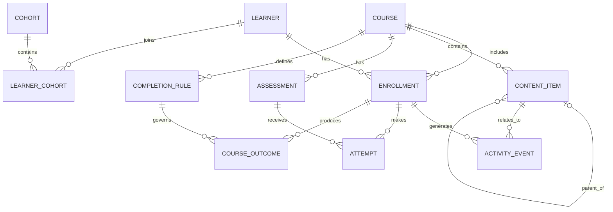

# Entity Relationship Diagram

This diagram summarizes the principal entities and relationships in the Learning Analytics Engine.

The SQL schema in `src/database/schema.sql` is the authoritative source for exact column names, keys, constraints, and relationship definitions.

## ER Diagram

## Main Entities

- **Learner:** Stores learner profile information and account status.
- **Course:** Stores course metadata and publication status.
- **Cohort:** Represents a grouping of learners.
- **LearnerCohort:** Connects learners to cohorts through membership records.
- **ContentItem:** Represents course content, its sequence, and its optional parent item.
- **Assessment:** Represents course assessments and passing requirements.
- **CompletionRule:** Defines the rules used to evaluate course completion.
- **Enrollment:** Represents a learner's registration in a course.
- **ActivityEvent:** Records learner interactions with course content.
- **Attempt:** Represents an assessment attempt and its result.
- **CourseOutcome:** Stores calculated course progress and completion status.

## Relationship Summary

- A learner can have multiple course enrollments.
- A course can have multiple enrollments, content items, assessments, and completion rules.
- Learners and cohorts are connected through learner-cohort membership records.
- Activity events are associated with enrollments and may reference content items.
- Assessment attempts connect enrollments with assessments.
- Course outcomes connect enrollments with the completion rules used to evaluate them.

The diagram is a conceptual overview. Refer to `src/database/schema.sql` when implementing queries or changing the database structure.
